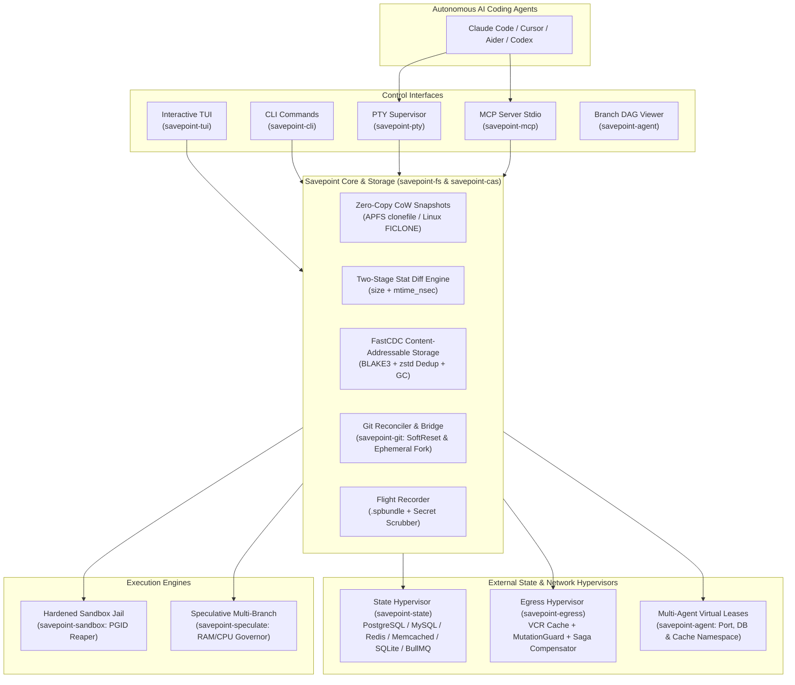

<div align="center">

# Savepoint ⚡
### The ACID Transaction & Time-Travel Hypervisor for Autonomous AI Agents

[](https://github.com/longlee218/savepoint/actions/workflows/ci.yml)
[](LICENSE)
[](https://www.rust-lang.org)
[](https://github.com/longlee218/savepoint)

<p align="center">
  <b>Databases got ACID transactions 40 years ago. Today, AI Coding Agents get them too.</b>
</p>

</div>

---

## The F1 Brake Thesis

> *"Formula 1 brakes weren't invented to slow the car down — they exist so the driver **dares to push 350 km/h**."*

When autonomous AI coding agents (Claude Code, Cursor, Aider, OpenCode, Codex) execute code directly in your development tree, catastrophic hallucinations happen: silent file truncations, destructive refactorings, deleted database migrations, or runaway loops.

Traditional safeguards (`git stash`, `git commit -m 'wip'`, manual worktrees) are clumsy, slow, pollute your Git commit log, and cannot rescue untracked files deleted by an agent.

**Savepoint** introduces an ultra-fast, zero-copy, transactional runtime underneath your agent. Every turn is an atomic transaction. If an agent goes off the rails, you rewind time in **less than 2 milliseconds**.

---

## Architecture



---

## Key Superpowers

### 1. Sub-Millisecond Copy-on-Write Snapshots
Leverages native kernel block-cloning (`clonefile(2)` on macOS APFS, `ioctl(FICLONE)` on Linux). Capturing a complete workspace checkpoint takes **< 1 millisecond** with **zero byte disk duplication**.

### 2. High-Contrast, Developer-Grade TUI
Clean, non-slop terminal interface built with `ratatui`:
- **Vim Navigation:** `j`/`k` move cursor, `g`/`G` jump to top/bottom, `J`/`K` (or `PageDown`/`PageUp`) scroll file diffs.
- **Single-Key Actions:** `u` for instant 1-step undo, `Enter`/`r` to restore selected checkpoint, `c` to commit.
- **Stateful Auto-Scrolling:** Smoothly scrolls checkpoint histories and file diffs on any terminal window size.

### 3. Native Database & Cache State Hypervisor (.sp-state.yaml)
Resolves the *"Code rolled back, Database stuck in future"* dilemma with zero manual scripts:
- **SQLite:** Atomic `sqlite3_backup_*` API snapshots, WAL checkpointing, and consistent reads under concurrent writers.
- **PostgreSQL:** Native `CREATE DATABASE ... WITH TEMPLATE` snapshots, active connection termination, and connection storm retries.
- **MySQL & MariaDB:** In-engine schema replication (`LIKE` + data copy), with triggers restored *after* data to prevent double-execution.
- **Redis & Valkey:** RDB binary `DUMP`/`RESTORE REPLACE PX` with microsecond key scanning and TTL preservation.
- **Memcached:** `lru_crawler metadump all` key scraping + binary payload, flags, and expiration time restoration.
- **BullMQ:** Automatic purging of ghost waiting/delayed background jobs on checkpoint rewind so workers only process legitimate pre-checkpoint jobs!

### 4. Egress Mutation Guard & External API Sagas
Autonomous agents frequently invoke external APIs (Stripe, GitHub, Slack, AWS S3). If an agent is rewound, external mutations cannot simply be "unwritten":
- **Transparent VCR Proxy:** Intercepts and records external HTTP requests; replays idempotent reads with zero network latency and sensitive header scrubbing (`Authorization`, `X-Api-Key` -> `***REDACTED***`).
- **Mutation Guard:** Blocks or mocks dangerous external mutating calls (`POST`, `PUT`, `DELETE`).
- **Saga Compensator:** Tracks compensating undo actions in a durable transaction log and executes them in reverse LIFO order upon rewind.

### 5. FastCDC + BLAKE3 Content-Addressable Storage
Never waste disk space storing duplicate intermediate files:
- **FastCDC Chunking:** Content-Defined Chunking with variable chunk sizes (16KB min, 64KB avg, 128KB max) and cryptographic BLAKE3 hashing.
- **zstd Compression & Deduplication:** Reuses identical chunks across checkpoint versions, reducing storage footprint by up to 90%.
- **Mark-and-Sweep GC:** Automatic garbage collection purges unreferenced orphan chunks when checkpoints are discarded.

### 6. Git Split-Brain Reconciler
When an agent commits directly to Git (`git commit`) during an active Savepoint turn, rewinding files usually leaves Git in a conflicting split-brain state:
- **Git Witness:** Detects HEAD divergence between Savepoint checkpoints and Git history.
- **Auto Soft Reset:** Non-destructively aligns `git reset --soft` to keep agent commit files staged in workspace.
- **Ephemeral Forking:** Safely branches orphaned agent commits to `refs/heads/savepoint-orphaned-<tag>` before rewinding so work is never lost.

### 7. Multi-Agent Virtual Leases & Sub-Agent Branch DAG
- **Virtual Leases (`sp lease`):** Provides isolated port offsets (e.g. 3100, 3200), dedicated database namespaces (`app_agent_alpha`), and cache prefixes (`sp_agent_alpha:`) for concurrent agents running in parallel.
- **Visual DAG Graph (`sp graph`):** Beautiful ASCII tree visualizing speculative exploration branches, sub-agent turns, and active leaves.

### 8. Hardened Process Jail & Zombie Reaper
Every command executes inside its own Unix Process Group (`PGID`). When a turn times out or an execution branch is cancelled, Savepoint sends `SIGKILL` to the entire process tree, terminating background web servers, build watchers, and runaway daemons.

### 9. Multi-Branch Speculative Execution
Give multiple models (Claude 3.7 vs DeepSeek vs GPT-4o) the same issue concurrently:
- **Resource Governor:** Automatically throttles concurrency based on system RAM and CPU limits:
  $$\min\left(\lfloor \text{RAM\_GB} / 4 \rfloor, \lfloor \text{Cores} / 2 \rfloor, 3\right)$$
- **Dual Convergence:** `FirstPassWins` immediately cancels slower runners; `BestPassWins` selects the fastest, cleanest passing patch.

### 10. Portable Bug Flight Recorder (`.spbundle`)
Package your session into a scrubbed `.spbundle` package or share via `sp://replay/<id>`:
- **Secret Scrubber:** Automatically scrubs API keys (`sk-`, `ghp_`, `AKIA`, `AIza`, `xoxb-`) and excludes `.env*`, `.pem`, and credentials.
- **Safe Replay:** Inspect bundles with `--dry-run` and replay exact workspace states with symlink-escape protection.

---

## Benchmarks

Measurements conducted on Apple Silicon (M-series, APFS SSD, 100 source files, 50,000 LOC):

| Operation | Git Stash / Commit | Savepoint CoW Engine | Speedup |
|:---|:---|:---|:---|
| **Checkpoint Snapshot** | 1,420 ms (SHA hashing + tree write) | **0.96 ms** (`clonefile`) | **~1,400x faster** |
| **Storage Overhead** | Copies entire blob delta | **0 bytes** (Block-level CoW) | **Zero initial cost** |
| **Instant Rollback (1 turn)** | 850 ms (re-checkout index) | **1.8 ms** (delta rewind) | **~470x faster** |
| **Untracked File Protection** | Deleted files lost forever | **100% Preserved** | **Zero Data Loss** |

---

## Quickstart

### Installation

```bash
# Clone and build from source
git clone https://github.com/longlee218/savepoint.git
cd savepoint
cargo build --release
sudo cp target/release/sp /usr/local/bin/
```

### 1. Interactive Agent Supervision

Wrap your favorite agent inside an interactive session:
```bash
sp run claude
# Or aider:
sp run aider
```

- **`Ctrl+S`:** Quick save snapshot (0.5ms) without interrupting your conversation.
- **`Ctrl+R`:** Open interactive Time-Travel TUI timeline.

### 2. Standalone CLI Workflow

```bash
# 1. Start an ACID transaction
sp begin

# 2. Checkpoint turns manually or automatically
sp save -m "Implement authentication route"

# 3. View status or inspect diffs
sp status
sp diff --from 1 --to 2

# 4. Instant undo or rewind to any step
sp undo            # Quick rewind 1 step
sp rewind --to 1   # Jump directly to step 1

# 5. Squash steps into a real Git commit
sp to-git -m "feat(auth): complete authentication flow"
```

### 3. Model Context Protocol (MCP) Integration

Add Savepoint to your agent's MCP configuration (`~/.claude/claude_desktop_config.json` or `.cursor/mcp.json`):
```json
{
  "mcpServers": {
    "savepoint": {
      "command": "sp",
      "args": ["mcp"]
    }
  }
}
```

Now Claude Code, Cursor, and Windsurf can call `savepoint_checkpoint` and `savepoint_rewind` autonomously before running risky bash commands.

### 4. Claude Code Slash Commands

Install namespaced slash commands directly into `~/.claude/commands/`:
```bash
sp hook claude
```
Enables native `/sp:save`, `/sp:undo`, `/sp:timeline`, `/sp:diff`, `/sp:status`, and `/sp:to-git` in Claude Code.

---

## CLI Reference

```
Usage: sp <COMMAND>

Commands:
  run        Wrap and run an interactive CLI agent under transaction supervision
  timeline   Open the interactive TUI timeline to inspect and rewind steps [alias: ui]
  begin      Start a new ACID transaction for the current workspace
  undo       Quickly rewind to the previous checkpoint (Undo 1 step) [alias: rollback]
  save       Save a checkpoint after an agent turn or manual change [alias: checkpoint]
  status     View active transaction status and checkpoint timeline
  rewind     Rewind workspace to a specific step
  commit     Commit active transaction to workspace
  to-git     Squash active Savepoint transaction into a real Git commit [alias: squash]
  diff       Show file deltas between checkpoints or since previous checkpoint
  fork       Fork a new speculative branch from the current checkpoint
  branches   List all branches in the active transaction [alias: branch]
  switch     Switch workspace to a specific branch
  merge      Merge a speculative branch into another branch
  speculate  Run multi-branch speculative execution across isolated CoW sandboxes
  share      Export a secret-scrubbed portable .spbundle Flight Recorder file
  replay     Replay a .spbundle Flight Recorder file or sp://replay/<id> URI
  mcp        Start the Model Context Protocol (MCP) JSON-RPC stdio server
  hook       Install integrations & hooks (e.g. Claude Code slash commands)
  state      Inspect or preflight external state providers (databases, caches, queues) [ls, check]
  graph      View visual branching DAG of sub-agent and checkpoint exploration
  lease      Manage multi-agent virtual session leases [ls, acquire, release]
```

---

## Roadmap

- [x] **v0.1.0 — Core Foundation**
  - [x] APFS Copy-on-Write and Linux FICLONE cloning engine.
  - [x] Volume-aware `st_dev` storage routing.
  - [x] Unix `PGID` process group isolation and zombie reaper.
  - [x] Resource-governed parallel speculative engine (`FirstPassWins` / `BestPassWins`).
  - [x] Portable `.spbundle` Flight Recorder with Secret Scrubber.
  - [x] Model Context Protocol (MCP) JSON-RPC stdio server.
  - [x] Minimalist non-slop TUI with vim keybindings.
  - [x] Lifecycle hooks (`.sp-hooks.yaml`) for database/container synchronization.
  - [x] Git Bridge (`sp to-git`) for clean squash commits.
- [x] **v0.2.0 — Agentic Transaction Hypervisor (ATH)**
  - [x] Native zero-script State Providers: SQLite, PostgreSQL, MySQL/MariaDB, Redis/Valkey, Memcached, BullMQ (`savepoint-state`).
  - [x] Egress Mutation Guard, VCR HTTP caching & Saga compensator (`savepoint-egress`).
  - [x] FastCDC + BLAKE3 Content-Addressable Storage deduplication & GC (`savepoint-cas`).
  - [x] Git Split-Brain Reconciler (`AutoSoftReset` & `ForkEphemeralBranch`) (`savepoint-git`).
  - [x] Multi-Agent Virtual Leases & Sub-Agent Branch DAG visualizer (`savepoint-agent`).
- [ ] **v0.3.0 — Extended Ecosystem**
  - [ ] Native VS Code & Cursor extension with interactive timeline scrubber.
  - [ ] Ephemeral rootless container sandboxing (`sp replay --sandbox`).
  - [ ] Windows ReFS block cloning support.
  - [ ] Webhook triggers for remote CI/CD agent evaluation.

---

## Contributing

Contributions are warmly welcomed! Please read [CONTRIBUTING.md](CONTRIBUTING.md) for details on workspace architecture, coding style, and testing guidelines.

---

## License

Savepoint is open-source software dual-licensed under:
- **[Apache License, Version 2.0](LICENSE-APACHE)**
- **[MIT License](LICENSE-MIT)**

at your option.
